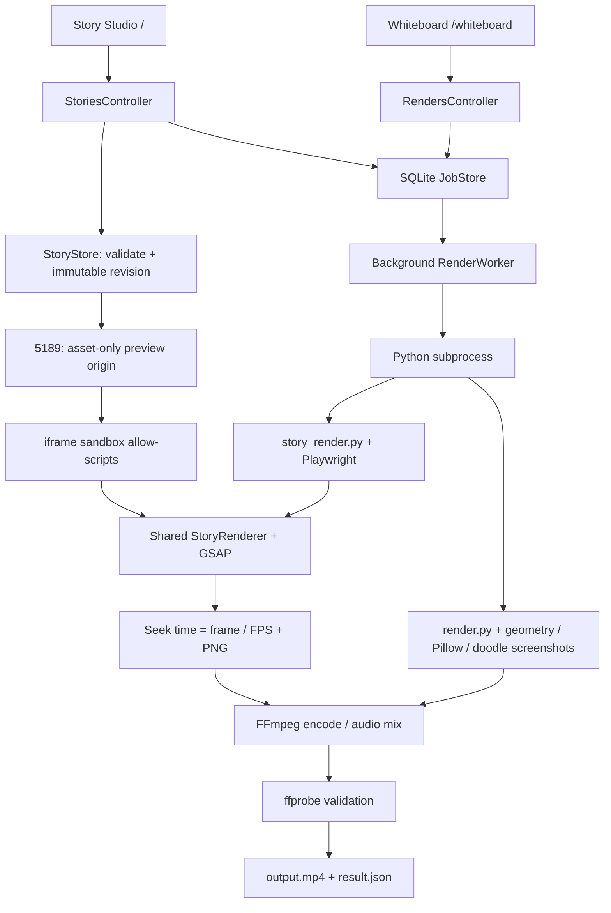

# Phase 01 — Architecture & Technical Audit

Ngày audit: **07/11/2026 (Asia/Bangkok)**. Phạm vi: toàn bộ source ứng dụng, engine Python, runtime browser, scripts, dependency manifests/locks, tests, samples và tài liệu trong workspace hiện tại.

**Kết luận:** đây đã là ứng dụng local có hai pipeline Whiteboard/Doodle và Story Studio. Multi-scene, shared character, GSAP runtime, ZIP project và MP4 Story đã được viết trong source; không nên lập kế hoạch như các module này chưa tồn tại. Tuy nhiên, chưa đủ bằng chứng nghiệm thu Story end-to-end, chưa có AI orchestration hay interaction model. Nên củng cố baseline và ranh giới thực thi trước khi mở rộng sản phẩm.

Audit này chỉ thêm tài liệu; không sửa business logic, dependency, test hay triển khai tính năng. Build/test tạo artifact và kiểm tra store trong `work/`; lần thử khởi động app có thể kích hoạt khởi tạo SQLite/recovery theo code hiện có. Không dừng tiến trình ứng dụng đang chiếm cổng. Workspace có nhiều file chưa được Git track và README đã thay đổi từ trước; không coi các thay đổi đó là kết quả Phase 01.

## 1. Current Architecture

### 1.1 Cấu trúc và trách nhiệm

| Thành phần | Hiện trạng / bằng chứng |
| --- | --- |
| Backend | ASP.NET Core MVC/Razor, .NET 8; `src/SvgToMp4.Web/Program.cs` và `Controllers/`. Minimal hosting, controller API, CSRF header, static files và CSP. |
| Frontend legacy | `Views/Studio/Index.cshtml`, `wwwroot/js/studio.js`, `wwwroot/css/studio.css`; JavaScript thuần, textarea SVG, ảnh SVG gốc và video preview. Route `/whiteboard`. |
| Frontend Story | `Views/Storyboard/Index.cshtml`, `wwwroot/story/studio.mjs`, `studio.css`; ES modules, DOM trực tiếp, textarea code, scene cards, timeline và iframe preview. Route `/`. Không React/Vue, không frontend bundler. |
| Domain/storage | `SvgToMp4.Core`: records trong `Models.cs`, SQLite job store, filesystem Story store, manifest/ZIP/SVG validation, Node syntax checking. |
| Worker | `SvgToMp4.Worker/RenderWorker.cs`: BackgroundService chạy trong web host, poll queue mỗi 500 ms, một job/lần, Python subprocess và JSON-line progress. Đây chưa phải dịch vụ worker độc lập. |
| Whiteboard engine | `engine/render.py`: validation, geometry bằng Chromium, stroke evaluator, Pillow compositing, FFmpeg raw RGB streaming; vendor `whiteboard_skill` dùng helper private. |
| Story engine | `engine/story_render.py`: Playwright điều khiển browser runtime, absolute seek, PNG screenshot từng frame, FFmpeg H.264, audio mix và ffprobe. |
| Browser animation | `wwwroot/story/runtime.js`, `timeline.mjs`, GSAP/MotionPath/MorphSVG vendored. Scene module export `createScene(context)`. |
| Dữ liệu | `data/studio.db` lưu jobs dạng JSON payload; `data/jobs/<id>/` lưu input/request/output/log; `data/stories/<id>/revisions/<revision>/` lưu snapshot; `project.json` là pointer revision mới nhất. Ngoài public root, bỏ qua Git. |
| Vận hành | `setup.ps1`, `start.ps1`, `start.cmd`; SDK pin trong `global.json`; Python package riêng tại `engine/.packages`; Chrome/Edge và FFmpeg lấy từ máy. |

Dependency project: **Web → Worker → Core**. Worker được đăng ký singleton và hosted service trong Web. Core hiện phụ thuộc cả filesystem, SQLite và executable `node`, nên chưa tách domain khỏi infrastructure.

### 1.2 Pipeline tổng thể



### 1.3 Các pipeline cụ thể

**Whiteboard:** API kiểm tra XML/mode/settings → ghi `input.svg` + `request.json` → queue → Python kiểm tra allowlist SVG nghiêm ngặt → browser đọc geometry/path points và ảnh màu cuối → helper vendor phân bố stroke timeline → Pillow vẽ nét/hand, blend màu, hold → raw RGB pipe → FFmpeg → kiểm tra frame/codec/kích thước/FPS/thời lượng → đổi tên partial thành MP4.

**Doodle:** cùng hạ tầng job, nhưng browser giữ nguyên nền và style của nét trong group `id="doodles"`, seek stroke progress rồi chụp frame; hand được ghép thêm nếu chọn. Không có giai đoạn tô màu. Không phải cùng thuật toán tạo pixel với whiteboard.

**Story preview:** import/lưu tạo revision → iframe `sandbox="allow-scripts"` trỏ `http://127.0.0.1:5189/story/runtime.html` → load manifest/assets/fonts → load scene HTML/CSS/module → tạo toàn bộ scene → master timeline xác định scene active/overlap → postMessage seek. UI dùng requestAnimationFrame để gửi thời gian; audio phát ở parent bằng HTMLAudioElement.

**Story export:** API chốt đường dẫn revision vào request → Windows Job Object giới hạn cây Python/browser/FFmpeg → browser offline với origin giả `https://story.invalid` và route chỉ phục vụ runtime/snapshot → gọi cùng `StoryRenderer.readyFrame(frame/fps)` → PNG pipe → H.264/yuv420p → FFmpeg mix audio thành AAC 48 kHz → ffprobe xác minh rồi publish output. Frame count là `ceil(duration * fps)`; thời lượng video hiệu dụng bằng số frame/FPS.

### 1.4 GSAP, Playwright, Chromium và FFmpeg

| Công nghệ | Cách dùng thực tế | Giới hạn |
| --- | --- | --- |
| GSAP 3.15.0 | `package.json` pin exact; `scripts/vendor-dependencies.mjs` copy ba file dist. `runtime.html` load GSAP, MotionPathPlugin, MorphSVGPlugin; runtime đăng ký plugins, pause timeline/ticker và seek tuyệt đối. | Có dependency/plugin không đồng nghĩa mọi hiệu ứng đã qua browser QA. Monkey-patch global GSAP làm các scene chung một miền trạng thái. |
| Playwright Python 1.64.1 | `render.py` và `story_render.py` dùng sync API; tests cũng dùng browser thật. Export Story có route interception và WebSocket blocking. | Khởi chạy browser/process là điều kiện môi trường; không có mock thay thế. |
| Chromium | `pw.chromium.launch(executable_path=browser_executable(), chromium_sandbox=True)`; ưu tiên `SVG_CHROME`, sau đó Chrome/Edge cài sẵn. | Không dùng browser revision cố định do Playwright cài; browser tự cập nhật có thể đổi geometry/pixel/API behavior. |
| FFmpeg / ffprobe | Executable trong PATH, libx264, CRF/preset, faststart, kiểm tra metadata/frame; Story mix trim/offset/fades/delay/amix bằng sample counts. | Chưa pin binary/version/hash. Story PNG screenshot mỗi frame và full-scene DOM tạo chi phí lớn ở 4K/60 FPS. |

Không có FFmpeg.wasm, GSAP server-side rendering, AI API, TTS hay GPU render implementation trong source được đọc.

## 2. Existing Features

“Có” dưới đây nghĩa là có implementation được đọc; mức kiểm chứng runtime xem mục 9, không mặc định mọi feature đã chạy thành công.

| Nhóm | Chức năng hiện có | Giới hạn thực tế |
| --- | --- | --- |
| SVG Editor | Legacy import/drop/paste SVG, sửa source, xem ảnh gốc; import PNG/JPEG thành SVG có nền; download SVG, localStorage draft. Story sửa SVG/JS/JSON/HTML/CSS bằng textarea. | Chưa có canvas editing, node/path handles, selection transform, undo/redo hay syntax diagnostics trong editor. |
| Preview | Legacy tạo MP4 preview 540p/15 FPS. Story live iframe, Play/Pause/restart, scrub, từng frame và chuyển scene. | Story preview chỉ mount revision đã lưu; đổi code phải “Lưu & áp dụng”. Không phải live update mọi phím gõ. |
| Timeline | Master scene/audio track, kéo sắp xếp scene, đổi duration, cut/fade/slide overlap, scene thumbnails, playhead/frame step. | Không có keyframe/property-track editor. Audio track chỉ hiển thị, chỉnh bằng manifest. |
| Import/Export | SVG legacy; Story ZIP, direct JS/SVG/HTML import; project create/list/save; export ZIP; binary assets giữ qua revision. | Không có nút upload/thêm/xóa asset hoặc scene đầy đủ; phải sửa manifest/files hoặc import ZIP. `.css` standalone không có nhánh direct import. Export ZIP lấy bản đã lưu, không tự lưu draft. |
| Multi-scene | 1–80 scene, tối đa 600 giây/scene, tổng tối đa 30 phút; normalize start/overlap, render toàn Story. | Khởi tạo tất cả scene cùng lúc; giới hạn sản phẩm không chứng minh hiệu năng ở kích thước tối đa. |
| Nhân vật | `characters[].assetId`, optional parts, `context.character`, shared SVG asset; assetText/addSvg/stroke; camera x/y/scale/rotation/follow. | Nhân vật được tạo instance từng scene, không có persistent actor state, rig/pose engine hoặc kiểm tra parts tồn tại. Background reference được validate; scene code vẫn cần tạo hình nền. |
| MP4 | Queue, progress, active/queued cancel, range download/playback, partial cleanup, immutable Story revision, metadata validation và audio AAC. | Một worker; không retry/resume frame/cache. Story dùng trạng thái `Completed`, legacy dùng `Succeeded`. |
| Chẩn đoán | Error console, JSON progress, `renderer.log`, `encoder.log`, Story `audio.log`, `result.json`. | Chưa có structured telemetry xuyên Web/Python, retained quotas hay dashboard vận hành. |

Sample `samples/lost-star/` và ZIP: 4 scene / 34,5 giây, shared character, transitions và chime audio. Đây là fixture có sẵn, không phải nội dung AI sinh trong ứng dụng.

## 3. Missing Features

Để thành **AI SVG Storyboard Studio** theo nghĩa sản phẩm có thể biên tập và sinh nội dung:

1. **AI workflow:** prompt → outline/storyboard có schema → asset/character plan → scene generation → validation → preview/review → revision được chấp nhận. Chưa có provider adapter, prompt/version registry, cost/cancellation, repair loop hay provenance.
2. **Mô hình authoring có cấu trúc:** scene CRUD/duplicate, asset upload/delete/reference tracking, character library, part/rig/pose contract, action clips, keyframes và undo/redo. Source code hiện là giao diện chính cho animation phức tạp.
3. **Tương tác:** chưa có event/action/state/branch schema, hit testing, user input routing, deterministic event recording hoặc export interactive bundle. MP4 là kết quả tuyến tính; cần quy định interaction replay thành một nhánh cụ thể để render video.
4. **An toàn code generated/imported:** threat model và security regression adversarial đủ mạnh, preview watchdog/quotas, capability model theo project, policy cho HTML/CSS/module helpers; export cần isolation OS được kiểm chứng.
5. **Chất lượng render:** acceptance suite chạy được, visual parity preview/export, nhiều thời điểm seek, profile matrix, audio drift test, reproducible environment và benchmark trước khi quảng bá 4K/60 FPS.
6. **Vận hành:** job leasing/recovery chuẩn, retention/GC revision/output, backup/migration, schema compatibility, capacity limits thực và health/version report.

Auth/multi-user/public hosting là phạm vi mở rộng riêng; hiện tại không có đăng nhập hay phân quyền và app được thiết kế local một người dùng.

## 4. Technical Debt

### 4.1 Findings ưu tiên

P1: cần giải quyết trước khi nhận code không tin cậy hoặc chốt nền tảng mở rộng; P2: cần trước khi tăng quy mô/chất lượng authoring; P3: cải thiện vận hành. Không có finding nào ở đây được gán “đã khai thác” khi chưa có kiểm thử động chứng minh.

| ID | Ưu tiên | Finding, tác động và bằng chứng | Hướng xử lý đề xuất |
| --- | --- | --- | --- |
| A01 | P1 | `tests/test_story_e2e.py` dùng `page.evaluate('token')` và `page.evaluate('project.id')`; các biến tương ứng được khai báo ở top-level **ES module** `studio.mjs`, không phải global page binding. Gate đầu tiên sẽ không lấy được module token. Đây là lỗi xác định qua code, chưa tái hiện bằng browser trong audit. | Kiểm thử qua DOM và `/api/session`; lưu project ID từ response thay vì private state. Sau đó chạy lại E2E thật. |
| A02 | P1 | Regex và monkey-patch runtime không phải sandbox JavaScript: alias/computed access, helper module, DOM và global state vẫn khả dụng; main scene bị regex-check API cấm nhưng helper JS không chịu cùng blacklist đó. `StorySyntax` chỉ parse. | Xem imported code là untrusted executable; lấy browser/OS isolation làm boundary, AST/capability lint làm hỗ trợ. |
| A03 | P1 | Preview CSP cho connect/script tới toàn origin 5189, server có ACAO `*` và route mọi revision biết ID. Không có capability riêng theo project; iframe token chỉ xác thực message. Không thể kết luận project A bị chặn đọc project B khi biết đường dẫn. | Giới hạn bundle theo preview session/capability, rà CORS và viết cross-project access tests. |
| A04 | P1 | Preview không có giới hạn CPU/RAM như export; vòng lặp vô hạn/DOM rất lớn có thể làm treo renderer. Parent `pending` chờ frame không có deadline; timeout 30 giây chỉ báo lỗi lúc mount. | Watchdog/terminate-and-remount và giới hạn tài nguyên, scene budget; test infinite loop/OOM có kiểm soát. |
| A05 | P2 | `JobStore.List()` chỉ lấy 200 dòng mới nhất nhưng worker tìm queued job và API đếm pending qua chính hàm này. Job cũ có thể bị bỏ đói; count rồi insert không atomic dưới request đồng thời. | Query queue/count riêng và atomic admission/claim; pagination cho history. |
| A06 | P2 | Timeline logic lặp trong `StoryValidation.Validate`, `timeline.mjs` và Python `layout`; docs schema chưa được thực thi bằng JSON Schema validator. Seed/parts/unknown fields chưa có cùng mức kiểm tra giữa các lớp. | Contract nguồn duy nhất và cross-language golden fixtures, giữ validator boundary-specific. |
| A07 | P2 | `SaveRevision` đọc/copy toàn bộ binary mỗi lần lưu; validation và spawn Node cho từng `.js` nằm trong global lock. `Save` kiểm tra tổng số file/bytes sau validation/syntax. | Early aggregate limits; tách archive/storage/validation; content-addressed assets khi có số đo cần thiết. |
| A08 | P2 | StoryRenderer tạo mọi scene/asset ngay từ đầu; global GSAP monkey-patch, CSS scene không scope, SVG IDs có thể trùng giữa scene/character instances. Callback bị suppress và reset không được gọi ở mỗi seek. | Scene lifecycle quản lý rõ, CSS/ID namespace, pure time evaluator; lazy scene chỉ khi bảo toàn seek parity. |
| A09 | P2 | Export ZIP không flush draft; import/sample có thể thay project chưa lưu mà thiếu dirty guard đồng nhất; reorder/duration rebuild plan trước remount, preview đang giữ revision cũ. | Central editor state/commands, unified dirty policy; chỉ đổi play plan sau apply hoặc hiển thị trạng thái chưa áp dụng rõ ràng. |
| A10 | P2 | `StorySyntax.Check` ghi toàn bộ stdin trước khi `WaitForExit(5000)`: deadline không bao toàn bộ write/read lifecycle. HTML/CSS import chưa sanitize tương đương SVG. | Parse service có deadline end-to-end; xác định subset HTML/CSS và DOM capabilities được hỗ trợ. |
| A11 | P2 | Storage append-only, không delete/GC/quota; pointer revision atomic nhưng file/DB job creation không là một transaction. Một số exception IO/Node missing không được `Guard` chuyển thành lỗi domain. | Transaction boundary/reconciliation, retention policy và lỗi có mã; không tự GC snapshot đang render. |
| A12 | P3 | Success states đôi (`Succeeded`/`Completed`), DTO Job dùng RenderSettings legacy cho cả Story, `OutputPath` absolute đi qua API; diagnostics stderr giữ trong queue nhưng không đưa vào lỗi/log bổ sung. | Enum/typed requests, public response DTO và structured diagnostics phù hợp. |
| A13 | P2 | Không CI, không test SDK/test adapter trong solution; `StoryChecks` là console project ngoài `.sln`; `npm test` không tồn tại. `dotnet test` không đại diện coverage. | One-command verification và CI phân tầng core/render/browser; E2E data isolation. |

### 4.2 Rà soát JavaScript import và security boundaries

**Đường thực thi:** ZIP/direct import → UTF-8 + path/type/reference/regex validation → `node --input-type=module --check` (không evaluate) → lưu revision → browser `await import(scene.source)` → top-level module code chạy → `createScene(context)` → `seek/reset/dispose` contract. Python và .NET không trực tiếp evaluate scene JS. Module có thể chạy code ở top-level trước lifecycle; kiểm tra lifecycle không phải phép cấp quyền.

**Biện pháp đã có:** ZIP traversal/symlink/duplicate/ratio/size checks, DTD disabled, SVG script/event rejection; loopback-only + AllowedHosts + CSRF trên mutations; iframe opaque origin qua `sandbox allow-scripts`, CSP và source/token/origin checks cho postMessage; parent render message bằng textContent, thumbnail SVG trong image Blob; export offline routing chỉ snapshot, Chromium sandbox bật, service workers/downloads bị tắt, WebSocket route đóng; worker kill process tree/timeout; Windows Job Object memory/process/CPU-time limits, lọc một số biến môi trường chứa TOKEN/SECRET/API_KEY.

**Giới hạn cần hiểu đúng:**

- Regex có thể false-positive trong comment/string và false-negative với alias/computed names. Không dùng kết quả lint để tuyên bố code an toàn.
- `context.root`/`sceneRoot`/`canvas` và global DOM/GSAP vẫn mở. Scene có thể sửa sibling/runtime state, giả message trong frame hoặc phá lifecycle. Shared runtime cần chống dữ liệu malformed ngay cả khi source window/token đúng.
- HTML qua `innerHTML`: script tag không tự tạo lifecycle; event handlers bị CSP inline-script policy hạn chế, nhưng HTML/CSS và DOM được scene JS tạo vẫn không phải dữ liệu đã sanitize toàn diện. Cần policy và tests riêng, tránh kết luận mọi HTML “inert”.
- Preview và export có chính sách khác: preview opaque HTTP origin + CORS; export HTTPS virtual origin không có iframe sandbox nhưng có offline routing. Dùng chung runtime chỉ giảm drift logic, không chứng minh parity hoặc isolation tương đương.
- Windows Job Object giới hạn tài nguyên/cleanup, không tước quyền filesystem/network của tài khoản OS. Gán process vào Job diễn ra sau khi process bắt đầu; cần kiểm chứng timing/inheritance. Environment marker `STORY_RESOURCE_GUARD` là guard quy trình, không phải cơ chế xác thực hay sandbox.
- Browser sandbox và request routing là lớp bảo vệ chính với scene JS, không phải bằng chứng chống browser exploit/native media decoder. Chưa có OS low-privilege identity/container/network-deny policy. Không có bằng chứng RCE/thoát sandbox trong audit này.
- Credential scrubbing theo tên không bao hết secrets. API/preview local không có xác thực theo project; CORS wildcard và loopback không tương đương authorization. Cần thử navigation, dynamic import, helper modules, cross-project reads và malformed media trong môi trường test cách ly.

### 4.3 Module tái sử dụng và refactor

| Module | Quyết định | Lý do |
| --- | --- | --- |
| Legacy engine + vendor assets | Giữ và bọc adapter ổn định | Chức năng riêng có giá trị, validation chặt; private upstream APIs phải pin commit. |
| `timeline.mjs` | Tái sử dụng làm timing contract | Pure functions, kiểm tra timeline hiện đã pass; bổ sung fixtures chung với C#/Python. |
| `StoryRenderer` / createScene v1 | Giữ API, refactor nội bộ từng bước | Có absolute seek/camera/assets; giảm global mutations và tăng isolation/lifecycle. |
| StoryStore/revisions/ZIP | Giữ format, tách implementation | Snapshot và optimistic concurrency tốt; tách storage, archive limits, syntax validation và migration. |
| Worker + FFmpeg + ffprobe | Giữ pipeline/validation, tách orchestration | Có cancel/partial/output checks; cần queue claim, profile, diagnostics và platform guard rõ. |
| `studio.mjs` / `studio.js` | Refactor theo responsibilities | State/UI/network/audio/transport gộp trong module lớn. Không cần đổi framework ngay để hoàn thành mục tiêu. |
| JobStore/models | Refactor | Queue/history và contract legacy/Story đang trộn. |
| AI/interaction/rig editor | Module mới | Hiện chưa có implementation tương ứng. |

## 5. Target Architecture

Đề xuất giữ ASP.NET Core, Python/Playwright, GSAP và FFmpeg để giảm migration risk; không viết lại toàn bộ.

```text
Studio UI
  Project state + commands/undo | Scene editor | Assets/characters | Timeline
          ↓ versioned project API
Application services
  Project/revision | Validation | Preview capabilities | Render scheduling
  AI storyboard orchestration → generated draft → validation → user review
          ↓
Versioned Story Document
  scenes + actors/parts + asset refs + action/keyframe tracks
  optional events/branches + deterministic replay input
          ↓ compiler/adapter
Shared deterministic runtime (createScene v1 compatibility)
  absolute time + seeded randomness + scoped scene lifecycle
      ↙ preview boundary            ↘ isolated render worker
  iframe/watchdog                  Playwright → FFmpeg → validation
          ↓
Infrastructure: project blobs/revisions, queue DB, logs, quotas/retention
```

- **Domain contract:** typed manifest, stable asset/actor IDs, timing/action schema và migration. Giữ importer v1, không bắt project cũ chuyển ngay.
- **Application layer:** controller mỏng; services xử lý save/import/export/render. Domain không phụ thuộc Node/SQLite/Python trực tiếp.
- **Runtime contract:** time → frame, scene-owned resources và dispose, seeded context; generated actions ưu tiên cấu trúc, custom JS là capability tùy chọn có boundary riêng.
- **AI layer:** provider-independent interface, schema-constrained output, source/provenance và revision review; không tự chạy code AI trong web host, không ghi đè revision đã chấp nhận.
- **Interaction:** event/branch graph chỉ cần cho mục tiêu tương tác; export MP4 sử dụng một replay/nhánh đã chọn. Interactive export cần format/runtime đầu ra riêng.
- **Infrastructure:** worker process tách khi cần capacity/fault isolation; giữ một worker local làm mặc định đến khi có số đo. Identity/network/filesystem isolation phải được thiết kế trước public hosting.

Khả năng nâng cấp: **khả thi theo hướng tiến hóa**, vì project/revision/timeline/runtime/render đã có; phần khó nhất là authoring contract, determinism, untrusted execution và kiểm chứng, không phải thêm API gọi model.

## 6. Implementation Roadmap

Chỉ là đề xuất; chưa thực hiện trong Phase 01. Thứ tự dựa trên dependency và điều kiện nghiệm thu, không ước lượng thời gian khi chưa chốt scope.

| Phase | Công việc | Điều kiện hoàn thành |
| --- | --- | --- |
| **02 — Baseline & execution boundary** | Sửa E2E module-state assumptions; chuẩn hóa runner/test data isolation; chạy legacy/Story preview+MP4 thật; kiểm chứng sandbox, helper imports, cross-project access, timeout và cancellation; sửa queue admission/claim. | Sample 34,5 giây/1035 frames có audio; matrix 24/30/60 FPS; seek ngược cùng timestamp; browser faults và cancel không để process/partial; legacy không regression. |
| 03 — Contracts & modularization | Tách storage/validation/queue/runtime/UI state, schema migration, golden timing fixtures, runtime version metadata. | ZIP v1 round-trip, stale-save conflict, output parity; không thay đổi nội dung/timing project cũ ngoài tolerance đã định nghĩa. |
| 04 — Storyboard authoring | Scene/asset CRUD, commands/undo, shared characters/parts, action/keyframe tracks, audio editor và dirty-state policy. | User tạo/chỉnh nhiều scene qua UI và export/reimport giữ nguyên dữ liệu. |
| 05 — AI draft pipeline | Storyboard/scene/asset adapters, schema output, validate/repair, provenance, review và cost/cancel. | Prompt tạo draft hợp lệ; malformed output không publish; người dùng kiểm tra trước apply; rendering vẫn dùng revision cố định. |
| 06 — Interaction & scale | Events/branches/replay, optional interactive export; render caching/lazy loading sau benchmark, retention và packaging. | Replay xác định xuất đúng nhánh MP4; benchmark máy đích, quota/recovery và migration được test. |

Không nên gộp đổi framework, nâng SDK lớn, cloud deployment và AI generation vào cùng Phase 02.

## 7. Compatibility Risks

| Ranh giới | Rủi ro | Cách bảo toàn |
| --- | --- | --- |
| Whiteboard/Doodle | Validator/renderer chung mới có thể làm SVG cũ bị từ chối hoặc khác pixel. | Giữ route/settings/default effect, samples và engine regression riêng. |
| Story format | `schemaVersion: 1.0`, outgoing-overlap convention, normalized start/duration và ZIP paths đã là hợp đồng hiện hành. | Version/migrate có chủ đích; round-trip fixture, không đổi interpretation âm thầm. |
| Custom scene API | Monkey-patch/callback suppression, nested timeline, reset/dispose semantics ảnh hưởng code đã import. | Compatibility adapter v1 + real GSAP fixture trước khi đổi runtime. |
| Browser/OS | External Chrome/Edge tự cập nhật; Story worker hiện chỉ Windows x64. | Ghi browser/runtime versions, test matrix; thêm isolation tương đương trước khi cho Linux/macOS render. |
| Origin/hosting | URL 5188/5189 và origin checks hard-code; host root suy ra từ content root `../..`. | Cấu hình origin/path có validation; publish layout riêng; giữ loopback-only mặc định. |
| Fonts/SVG/CSS | System fonts, duplicate IDs, style leakage, bỏ root SVG attrs khi `addSvg` chép child nodes có thể làm khác hình. | Bundled fonts, scope IDs/styles, fixture viewBox/root attributes và visual comparisons. |
| Audio/timing | HTMLAudio realtime preview khác offline 48 kHz FFmpeg; screenshot không bảo đảm realtime speed. | Test offsets/fades/drift; frame/sample based truth và duration rounding rõ. |
| Jobs/storage | Trạng thái đôi, JSON payload không có migration, filesystem pointer/SQLite độc lập. | Backward-compatible readers, migration/backup và job-state tests. |
| Dependencies/license | GSAP dùng license riêng; upstream MIT và notices/hand assets; FFmpeg binary hiện có GPL build flags. | Giữ notices, inventory và xác minh điều kiện phân phối chính thức trước packaging. Audit này không xác nhận pháp lý/license clearance. |
| Reproducibility | Exact npm/NuGet locks có sẵn nhưng setup dùng npm install/restore không locked mode; Python chỉ pin version, không hash; browser/FFmpeg không pin. | CI locked restore/npm ci, controlled Python wheels/hashes và binary inventory sau khi được duyệt. |

## 8. Proposed File Changes

**Thay đổi thực tế Phase 01: chỉ `docs/01-architecture-audit.md`.** Các file dưới đây là đề xuất cho phase sau, chưa tạo/sửa.

| File / nhóm file | Thay đổi đề xuất | Phase |
| --- | --- | --- |
| `tests/test_story_e2e.py` | Dùng session API/response thay private ES-module bindings; rõ skip/fail; isolated data root. | 02 |
| `scripts/check-story.ps1`, `.sln`, test configuration/CI mới | Runner chạy đủ test layers, kết quả nonzero rõ, tách browser prerequisites. | 02 |
| `src/SvgToMp4.Core/JobStore.cs`, `Controllers/{Stories,Renders}Controller.cs`, `RenderWorker.cs` | Atomic capacity/queue claim, tách history pagination và query pending. | 02 |
| `StoryPreview.cs`, `Program.cs`, `wwwroot/story/{studio.mjs,runtime.js}` | Preview capabilities theo project, CSP/CORS tests, message validation/deadline/watchdog. | 02 |
| `tests/security/` mới, `StoryProcessBoundary.cs`, `engine/story_render.py` | Adversarial scenes, OS inheritance/resources/cancel tests; harden theo kết quả. | 02 |
| `Core/StoryProjects.cs`, `Core/StorySyntax.cs` → services/contracts/infrastructure | Early limits, syntax timeout, archive/storage separation, typed validation/errors. | 03 |
| `docs/story.schema.json`, `docs/animation-code-contract.md`, timing fixtures mới | Align schema/runtime, versioning/migration và cross-language fixtures. | 03 |
| `wwwroot/story/runtime/` và `wwwroot/story/studio/` mới | Tách renderer/assets/camera/lifecycle và editor state/transport/audio/API; giữ entrypoints compatibility. | 03 |
| `Core/Models.cs`, renderer helpers, render profile/protocol contract mới | Typed jobs/results, consistent success states và renderer/browser metadata. | 03 |
| Scene/asset/character/action editor modules mới | CRUD, rig contract, keyframes/undo và audio authoring. | 04 |
| `Application/AI/` + provider adapters/contracts và UI draft review mới | AI-generated drafts, validation/repair/provenance/cost control. | 05 |
| Interaction/replay schema + runtime modules mới | Events/branches/replay và export policy. | 06 |
| `README.md`, setup/start scripts, dependency locks/notices | Đồng bộ status mới sau E2E, deterministic setup và packaging requirements. | 02–06, theo thay đổi được duyệt |

## 9. Build, Test & Dependency Baseline

### 9.1 Môi trường quan sát được

- Windows x64; SDK chọn bởi `global.json`: **8.0.121** (`rollForward: latestFeature`). Máy có thêm SDK 5.0.416 và 9.0.306; build đang dùng 8.0.121.
- Node **24.11.1**, npm **11.6.2**, Python **3.11.14** từ môi trường LibreOffice trên máy.
- FFmpeg/ffprobe: **2026-07-30 git 2ae2413488 full_build**, có libx264. Audio test thực chạy thành công.
- `npm ls --depth=0`: **gsap@3.15.0** có trong `node_modules`. Ba file vendored GSAP/MotionPath/MorphSVG khớp SHA-256 với dist đã cài. So sánh này xác minh tính nhất quán local, không chứng minh supply-chain authenticity.
- Các package Python được hỏi qua metadata trong `engine/.packages`: Playwright **1.64.1**, Pillow **13.0.0**, NumPy **2.4.6**, Pydantic **2.14.3**, defusedxml **0.7.1**, greenlet **3.5.6**; khớp lock tương ứng. Lock còn annotated-types, pydantic_core, pyee, typing-inspection/extensions.
- NuGet direct dependency: `Microsoft.Data.Sqlite 8.0.33`; transitive SQLitePCLRaw **2.1.13** và packages lock có sẵn. Không restore/upgrade dependency trong audit.
- Không lấy được browser version cho lần audit này vì browser-dependent checks không hoàn tất; số Chrome trong tài liệu cũ không phải baseline mới.

### 9.2 Kết quả đã chạy

| Lệnh / kiểm tra | Kết quả mới trong Phase 01 |
| --- | --- |
| `dotnet build SvgToMp4.sln --no-restore -m:1 -nodeReuse:false -p:UseSharedCompilation=false --verbosity minimal` | **PASS**, 0 warnings / 0 errors, khoảng 3,55 giây. Dùng cache restore sẵn có; chưa chứng minh clean install. |
| `dotnet run --project tests/StoryChecks/StoryChecks.csproj --no-restore -- D:\Source\svg-to-mp4-tool` | **PASS, 21 checks**: sample, ZIP round-trip, immutable revisions/conflict, traversal, validation và JS syntax. Test dọn thư mục riêng dưới `work`. |
| `node tests/story-timeline.mjs` | **PASS**: scene boundaries, overlap/final frame, nonsequential locate, audio offsets và seeded random. Đây không phải test GSAP/browser. |
| `python tests/test_story_audio.py` | **PASS**, FFmpeg thật: 72 H.264 frames, AAC, 3 giây, trim/offset/fades và khoảng có âm thanh. |
| `python tests/test_engine.py EngineTests.test_active_content_rejected EngineTests.test_embedded_image_validation EngineTests.test_absolute_seek` | **PASS, 3 tests**, khoảng 0,5 giây; không cần browser. |
| `node --check` cho `runtime.js`, `studio.mjs`, `js/studio.js` | **PASS**, không có syntax diagnostics. Không evaluate code hoặc chứng minh behavior. |
| `dotnet test SvgToMp4.sln --no-build --no-restore --verbosity normal` | **FAIL exit 1**, VSTest target FAILED nhưng 0 warning/error diagnostics và không có test count. Solution chỉ có 3 production projects; không có test adapter/project trong solution. Không báo thành pass. |
| `python tests/test_engine.py` toàn bộ | **Không hoàn tất**: in `..` rồi không có kết quả tổng; đã ngắt phiên thử. Không suy ra 8/8 pass. Browser/real-video cases chưa xác minh. |
| Chuỗi `python tests/test_story_e2e.py; python tests/test_app.py; python tests/test_doodle_app.py; python tests/test_mode_validation.py` | **Không hoàn tất**: không có test output trước khi ngắt phiên thử. Không có bằng chứng các script sau Story E2E đã được chạy; tất cả browser suites chưa có baseline pass. |
| Thử chạy lại các cases riêng bằng subprocess runner có timeout | **BLOCKED** ngay khi tạo subprocess với `sys.executable`: `PermissionError [WinError 5] Access is denied`. Không phát sinh kết quả test riêng từ runner này. |
| `dotnet run --no-build --no-restore --project src/SvgToMp4.Web/SvgToMp4.Web.csproj` | **FAIL**, bind 127.0.0.1:5188 báo address in use / SocketException 10048. Không dừng process đang chiếm cổng, không xác định instance đang chạy là source version nào. |
| HTTP probe Python tới 127.0.0.1:5188 và :5189 | **BLOCKED**, cả hai báo WinError 10013: socket access forbidden. Vì vậy không nghiệm thu API/UI instance đang chạy. |
| `dotnet --info` | Có thông tin SDK/runtime nhưng phần workload query lỗi Access denied khi mở Windows Service Control Manager; build độc lập vẫn pass. |
| `npm audit --json --fetch-retries=0 --fetch-timeout=15000` | **BLOCKED/exit 1**, ENOTFOUND `registry.npmjs.org`; không có vulnerability verdict. Không chạy thêm online NuGet/Python advisory scan trong môi trường này. |

Không chạy lại `setup.ps1`, npm install/vendor hoặc dependency upgrade vì dependency local đủ cho các checks độc lập và phase này chỉ audit. Không có kết luận “không có CVE”; chỉ xác nhận dependency inventory và các kiểm tra nêu trên.

### 9.3 Khoảng trống kiểm chứng và cách đọc tài liệu cũ

`docs/verification.md` và `docs/story-verification.md` là bằng chứng lịch sử, không được dùng thay cho baseline lần này. Cụ thể tài liệu Story cũ nói thiếu GSAP; hiện package và ba vendor scripts đã tồn tại, nên blocker dependency đó không còn đúng trong snapshot này. README/status cũ cần đồng bộ sau khi E2E được sửa và chạy thành công.

Chưa xác minh trong Phase 01: browser rendering/opaque-origin module loading, GSAP/nested/morph behavior, 34,5 giây Story MP4, preview/export visual parity, cancellation sau Chromium start, Job Object behavior, legacy browser regressions và 4K performance. Các hạn chế môi trường là kết quả quan sát, không phải kết luận business logic của các feature này sai.

**Điểm dừng:** Phase 01 kết thúc ở audit và baseline trên. Chờ người dùng kiểm tra tài liệu trước Phase 02; chưa thực hiện các Proposed File Changes.
